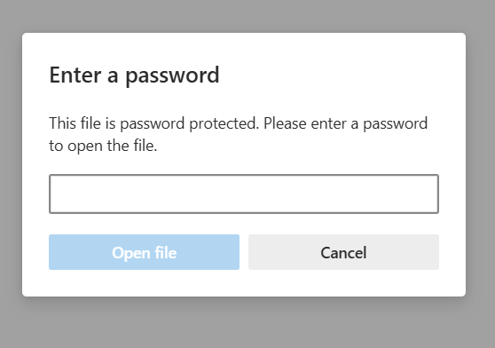
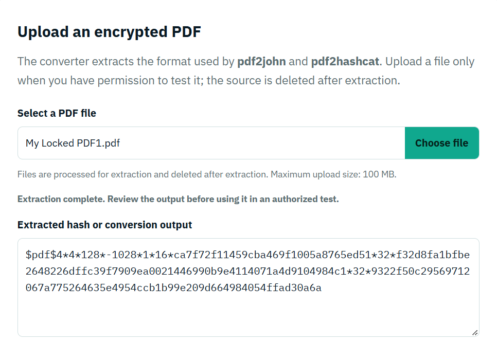
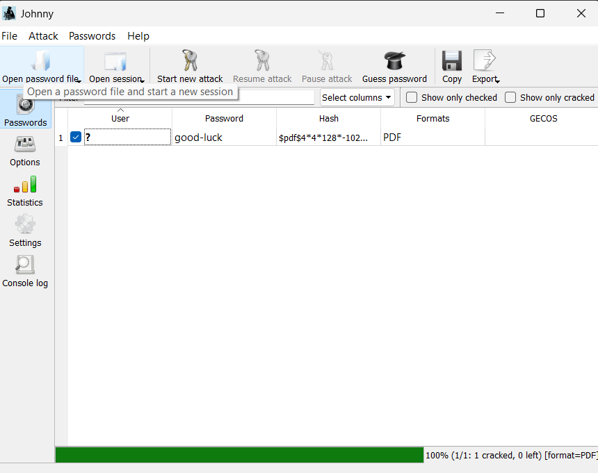
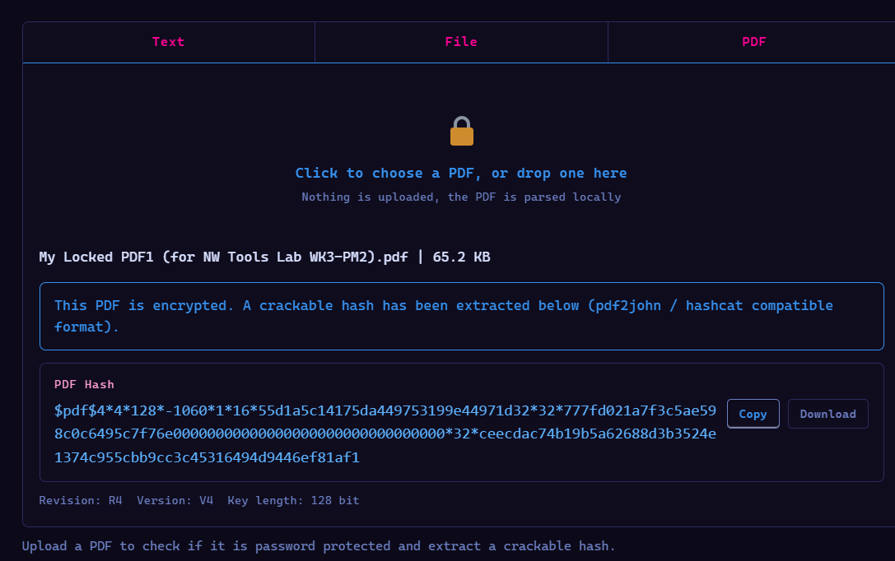
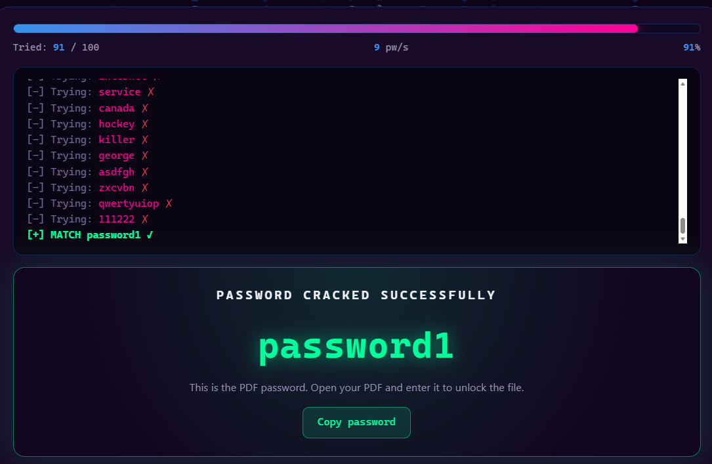

# Networkwalks-Week3-Cybersecurity-Lab

# 🔐 Password Cracking – Cybersecurity & Ethical Hacking Lab

## 📌 Project Overview

This repository documents the hands-on cybersecurity practicals completed as part of the **Networkwalks Week 3 Cybersecurity Project**.

The project focuses on understanding how password-protected PDF files can be tested using hash extraction and dictionary-based password recovery techniques.

Two different approaches were explored:

1. **Module 1 – Password Cracking using John the Ripper (JTR) and Johnny**
2. **Module 2 – Password Cracking using Networkwalks Tools**

Through these practical exercises, we explored how to extract password hashes from encrypted PDF files, perform dictionary-based password attacks, recover passwords, and verify successful access to protected documents.

---

## 🎯 Project Objectives

- Understand password protection in PDF documents.
- Learn the concepts of hashing and encryption.
- Extract password hashes from encrypted PDF files.
- Understand dictionary-based password attacks.
- Gain practical experience with John the Ripper and Johnny.
- Explore Networkwalks Hash Calculator and Password Cracker.
- Recover passwords from authorized test files.
- Understand the importance of strong password practices.

---

# MODULE 1: Password Cracking using John the Ripper (JTR)

## 1. Introduction

**John the Ripper (JTR)** is an open-source password security auditing and password recovery tool.

**Johnny** is the graphical user interface (GUI) for John the Ripper. It provides a user-friendly interface to perform password recovery operations.

In this module, John the Ripper and Johnny were used to recover the password of an encrypted PDF file.

### Tools Used

- John the Ripper
- Johnny GUI
- Online PDF Hash Extractor
- Notepad
- Windows Operating System
- Encrypted PDF test file

## 2. Implementation – Step by Step

### Step 1: Identify the Password-Protected PDF

Started with the provided encrypted PDF file.

When attempting to open the document, a password prompt appeared, indicating that the PDF was password protected.

### Step 2: Extract the PDF Hash

Used an online PDF Hash Extractor to upload the encrypted PDF and extract its corresponding password hash.

The extracted hash was required as input for the password recovery process.

### Step 3: Configure and Use Johnny

Installed John the Ripper and Johnny GUI.

Configured Johnny by navigating to Settings and selecting the `john.exe` executable from the John the Ripper installation directory.

The extracted PDF hash was loaded into Johnny through the **Open Password File** option.

### Step 4: Start the Password Recovery Process

Selected **Start New Attack** to initiate the password recovery process.

Johnny used the configured John the Ripper engine to test password candidates against the extracted PDF hash.

The process was monitored through the application interface.

### Step 5: Recover the Password

The password recovery process successfully identified a matching password.

### Step 6: Verify the Result and Capture the Flag

Opened the original encrypted PDF and entered the recovered password to verify access.

Successfully completed the practical and captured the first completion flag.

---

# MODULE 2: Password Cracking using Networkwalks Tools

## 1. Introduction

In this module, two browser-based tools provided by Networkwalks were used:

**1. Hash Calculator**

Used to extract the password hash from an encrypted PDF file.

**2. Password Cracker**

Used to perform dictionary-based password testing against the extracted hash.

### Tools Used

- Networkwalks Hash Calculator
- Networkwalks Password Cracker
- Web Browser
- Windows Operating System
- Encrypted PDF test file

## 2. Implementation – Step by Step

### Step 1: Upload the Encrypted PDF

Opened the Networkwalks Hash Calculator and selected the PDF option.

Uploaded the provided encrypted PDF file for processing.

The tool processed the document and extracted a password hash in a format beginning with `$pdf$`.

### Step 2: Extract the PDF Hash

The Hash Calculator successfully extracted the hash from the uploaded PDF.

Copied the complete extracted hash value for use in the password recovery process.

### Step 3: Open Networkwalks Password Cracker

Opened the Networkwalks Password Cracker in the browser.

Pasted the extracted PDF hash into the input field.

### Step 4: Perform a Dictionary Attack

Selected the available built-in wordlist and started the cracking process.

The tool tested different password candidates against the extracted hash until it identified a matching password.

### Step 5: Successfully Recover the Password

Monitored the cracking progress through the application interface.

The tool successfully identified the matching password and displayed the recovered result.

### Step 6: Verify the PDF and Capture the Flag

Opened the original encrypted PDF and entered the recovered password.

The document opened successfully, confirming that the password recovery process was successful.

Captured the second completion flag after completing the practical.

---

# ⚙️ Technical Concepts Learned

## 1. Hashing

Hashing is a one-way process that converts input data into a fixed-length representation called a hash.

It is commonly used in password verification and data integrity checking.

## 2. Encryption

Encryption converts readable information into an unreadable format using an encryption key.

The original information can be recovered through the appropriate decryption process.

## 3. PDF Hash Extraction

PDF hash extraction involves obtaining password-verification data from a protected PDF file.

The extracted hash can be supplied to compatible password recovery tools for authorized security testing.

## 4. Dictionary Attack

A dictionary attack is a password recovery technique in which a tool tests password candidates from a predefined wordlist.

When a candidate matches the password hash, the corresponding password is identified.

## 5. Password Security

The practical demonstrated how weak and commonly used passwords can be vulnerable to dictionary-based attacks.

Using long, unique passwords with a combination of uppercase letters, lowercase letters, numbers, and special characters helps improve password security.

---

# 📊 Project Outcomes

| Module | Tool Used | Outcome |
|---|---|---|
| Module 1 | John the Ripper | Password recovery successful |
| Module 1 | Johnny GUI | Hash loaded and password recovered |
| Module 2 | Networkwalks Hash Calculator | PDF hash extracted successfully |
| Module 2 | Networkwalks Password Cracker | Password recovered successfully |
| Final Verification | PDF Reader | Protected PDF opened successfully |

### Key Achievements

- Gained hands-on experience with John the Ripper and Johnny.
- Learned how to configure a password recovery environment.
- Extracted password hashes from encrypted PDF files.
- Understood dictionary-based password attacks.
- Explored two different password recovery approaches.
- Successfully completed both practical modules.
- Improved understanding of password security and ethical hacking.

---

# 🔒 Ethical Considerations

Password cracking techniques should only be used for authorized security testing, educational exercises, and files for which permission has been granted.

All activities documented in this repository were performed as part of an educational cybersecurity practical using the provided test files.

The objective is to understand password vulnerabilities and promote better security practices.

---

# 🔗 References & Resources

**John the Ripper**

https://www.openwall.com/john/

**Johnny GUI**

https://openwall.info/wiki/john/johnny

**Online PDF Hash Extractor**

https://www.onlinehashcrack.com/tools-pdf-hash-extractor.php

**Networkwalks**

https://networkwalks.com/

---

# 👩‍💻 Author

**Arya Ghare**

Networkwalks – Week 3 Cybersecurity Project

---

⭐ If you found this project useful, feel free to explore the implementation and screenshots!
